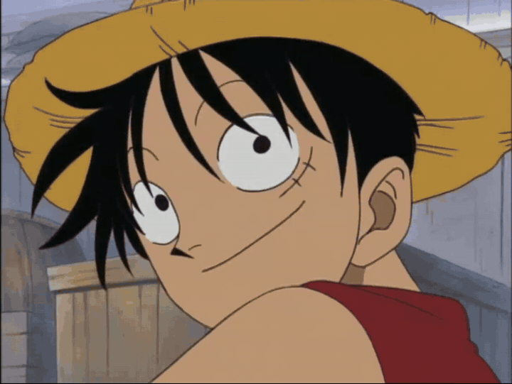
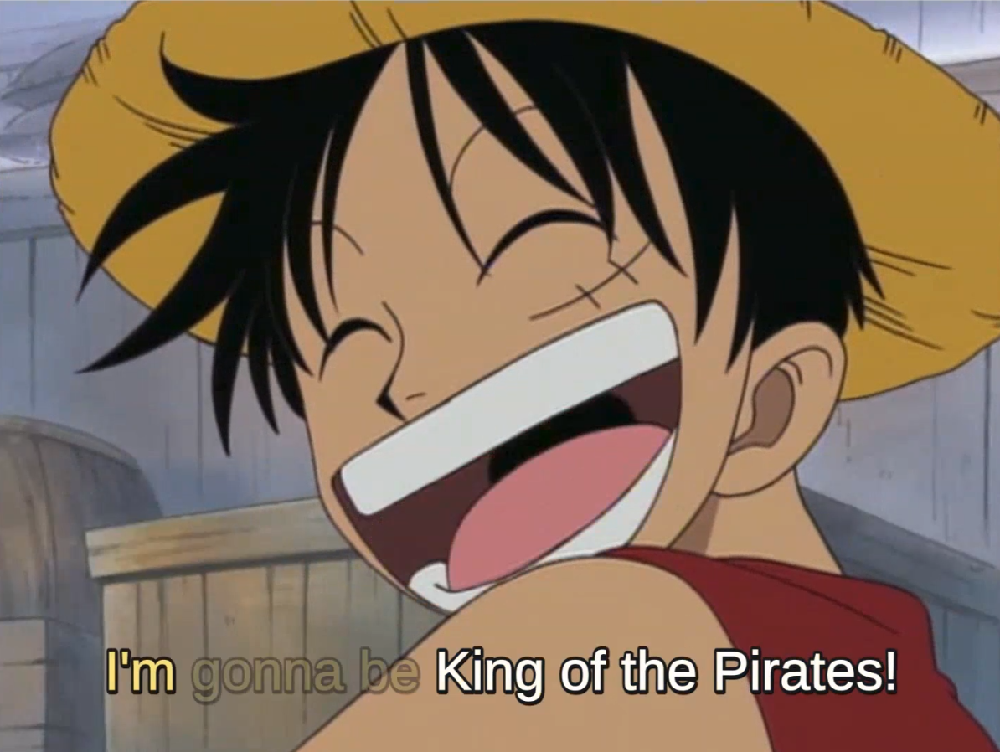
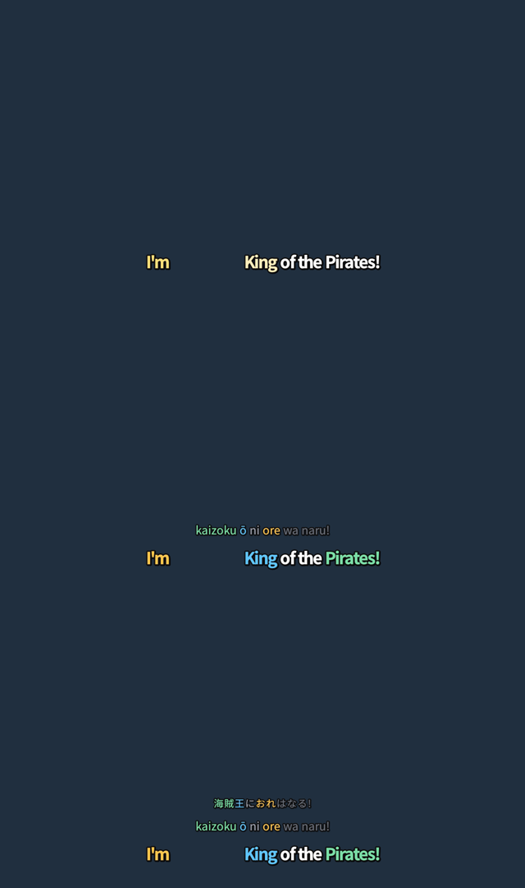

<h1 align="center">mimikara 耳から</h1>

<p align="center"><em>Anime subtitles that teach you Japanese while you watch.</em></p>

<p align="center">
  
</p>

Each English word appears **at the moment its Japanese counterpart is spoken**, yet the
finished line still reads left to right in plain English. You keep watching with
English subtitles and pick up Japanese word order and vocabulary without trying.

<p align="center">
  
</p>

Luffy says **海賊王に おれは なる!** (*kaizoku-ō ni ore wa naru*, literally "Pirate King,
I will become"). The subtitle shows *King of the Pirates* first, then *I'm*, and only
when he finally says なる does *gonna be* light up. Words never move or reflow; they
only change colour and opacity.

Optional romaji and Japanese lines light up word by word, colour-paired with the English:

<p align="center">
  
</p>

## Quick start

```sh
pip install -e '.[dev]'          # fugashi + UniDic + anthropic + pytest; needs ffmpeg on PATH
export ANTHROPIC_API_KEY=...     # or: --llm ollama for a local model

mimikara build ep01.ja.srt ep01.en.srt -o ep01.ass --all-modes
mpv ep01.mkv --sub-files=ep01.en.ass:ep01.romaji.ass:ep01.japanese.ass   # press j to cycle modes
```

That takes a Japanese and an English subtitle file for the same episode and writes:

| file | what you see |
|---|---|
| `ep01.en.ass` | English only (default). The newest word glows briefly. |
| `ep01.romaji.ass` | + romaji line, colour-paired with the English |
| `ep01.japanese.ass` | + Japanese script line |
| `ep01.all.ass` | every layer, for the browser extension |
| `ep01.mimikara.json` | the word alignment and timing, editable |

## How it works

```
 Japanese subs ─┐
                ├─► pair cues ─► tokenise ─► link words (LLM) ─► time words ─► render .ass
 English subs  ─┘   by time      fugashi     Claude / Ollama     morae, or    colour & alpha
                                 + UniDic    cached per line     WhisperX     only, no reflow
```

1. **Pair** cues from the two files by time overlap, merging or splitting where they
   segment differently.
2. **Tokenise** the Japanese with fugashi + UniDic (verb stems keep their endings:
   食べたくない is one word) and romanise with cutlet.
3. **Link** each English word to the Japanese word that carries its meaning, asking an
   LLM for JSON. Results are cached per line. `--literal` first rewrites loose official
   lines so more words can link.
4. **Time** each Japanese word by mora count, or from the audio with
   `--audio ep01.mkv` (WhisperX or Montreal Forced Aligner). Anchors you set by hand
   always win.
5. **Render** `.ass` with `\t` colour/alpha animations only, so lines never shift.

## Fix timing by hand

```sh
mimikara edit ep01.mimikara.json --audio ep01.mkv
```

A small local page with the waveform and the Japanese words as draggable blocks.
Drag a word to pin when it starts, `space` to hear the line, `s` to save, then
`mimikara render` again.

## Watch on a streaming site

[`extension/`](extension/) is a Chrome extension that overlays `ep01.all.ass` on the
page's video with [JASSUB](https://github.com/ThaUnknown/jassub) and has toggles for the
romaji and Japanese lines. Load it unpacked, open the episode, click the button, pick
the file. Tested on Crunchyroll and YouTube.

## The JSON in the middle

Every stage reads and writes the same file, so you can inspect or hand-edit any step:

```jsonc
{ "lines": [ {
    "start": "0:00:00.50", "end": "0:00:04.50",
    "ja": [ { "text": "海賊", "romaji": "kaizoku" }, { "text": "王", "romaji": "ō", "start_ms": 1000 },
            { "text": "に", "romaji": "ni", "role": "particle" }, ... ],
    "en": [ { "text": "I'm", "ja": [3] }, { "text": "gonna be", "ja": [5] }, { "text": "King", "ja": [1] },
            { "text": "of the", "ja": [] }, { "text": "Pirates!", "ja": [0] } ]
} ] }
```

`start_ms` is a manual anchor (relative to the cue start). Forced alignment adds
`align_ms`; merged cues add `cue_ms`; everything else is estimated from morae.

## More

- `pytest` runs the suite (pairing, morae, timing, rendering, alignment, editor).
- `tools/mpv_cycle_check.py` drives mpv headless and screenshots each mode.
- `extension/dev/test_extension.py` loads the extension in Chromium and screenshots the overlay.
- On Python 3.14, install WhisperX with `pip install --no-deps whisperx` plus
  `"ctranslate2>=4.6" faster-whisper torch torchaudio transformers pandas nltk pyannote.audio`.
- `PLAN.md` has the roadmap; `prototype/mimikara.py` is the original single-file prototype.

The clip and frame above are from *One Piece* episode 1, © Eiichiro Oda / Shueisha,
Toei Animation, used here briefly to illustrate the idea. Make subtitle files for your
own viewing; don't redistribute them.
